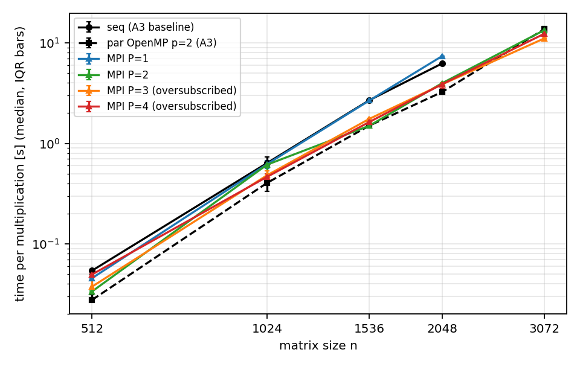
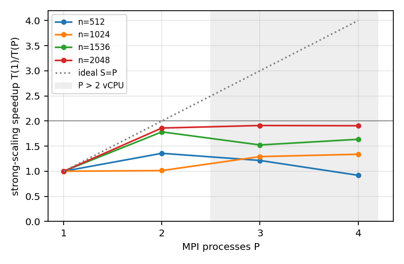
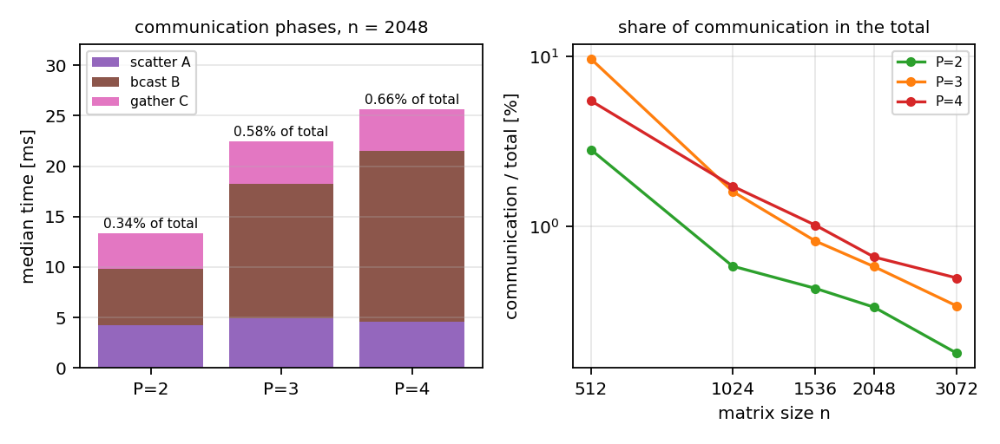

# Assignment 4 — Distributed Dense Matrix Multiplication with MPI: Scaling, Communication and Overhead

<p class="meta">Big Data · Grado en Ciencia e Ingeniería de Datos · ULPGC 2026-2027 · Individual Assignment 4 · Andrea Patruno · November 2026</p>

<p class="meta">GitHub repository (code, raw data, scripts): <a href="https://github.com/andreapatruno1/Assignment4_BD">https://github.com/andreapatruno1/Assignment4_BD</a></p>

**Abstract.** We ask how a distributed matrix multiplication scales with the number of worker processes, and how much of its time goes to computation, communication and framework overhead. The implementation uses MPI (Open MPI 5.0) with a 1-D row-block decomposition: rank 0 scatters bands of A, broadcasts B, every rank computes its band of C with the validated kernel of Assignment 3, and rank 0 gathers C. It is compared with the sequential and OpenMP versions of Assignment 3 on the same inputs and machine. All runs are **local**: one virtual machine with 2 logical processors, P = 1–4 processes. Results are bitwise identical to the sequential baseline. Communication is below 1 % of the total from n = 1024 upwards (0.34 % for P = 2 at n = 2048) and the measured traffic matches the model exactly. Strong-scaling speedup reaches 1.86–1.91 at n = 2048 and is capped by the 2 vCPUs; P > 2 brings no reliable gain. Memory grows with P because B is replicated (287 MiB at P = 4 vs 98 MiB for OpenMP at n = 2048). Differences of 10–20 % between MPI and OpenMP are not reproducible on this host. Conclusions do not cover inter-machine networks.

## 1. Introduction and objective

Assignment 3 used threads that share one memory. A distributed framework instead runs separate processes, each with its own memory, that cooperate only by sending messages; this is the model that lets a computation use several machines [1], [2]. The price is that data must be moved explicitly and that the framework adds start-up and synchronisation costs.

**Research question.** How does the run time of an MPI matrix multiplication change with the number of processes P for a fixed problem size (strong scaling), how is this time divided among computation, communication and framework overhead, and how does it compare with the sequential and shared-memory versions on the same hardware?

**Hypotheses (stated before measuring).** H1: communication (O(P·n²) bytes) is small compared with computation (O(n³/P) per process) and its share falls as n grows. H2: the speedup is at most 2, the number of logical processors; P > 2 gives no gain. H3: inside the timed region MPI with P = 1 costs the same as the sequential code, and MPI with P = 2 the same as OpenMP with 2 threads plus the communication time. H4: total memory grows with P, because every process holds a full copy of B.

*Factors changed:* P (and n). *Outcomes:* time per multiplication and its phases, speedup, memory per process, bytes transferred, launch overhead.

## 2. Background

**MPI.** The Message Passing Interface is a standard library interface for programs made of processes with separate address spaces [2]. Each process has a *rank* 0…P−1. *Collective* operations involve all ranks: `MPI_Scatterv` sends a different block of a buffer from a root to each rank, `MPI_Bcast` sends the same buffer to all, `MPI_Gatherv` collects blocks at the root, `MPI_Barrier` waits until all ranks arrive. The library chooses the algorithm of each collective (for example linear or tree-based broadcast) [4]. Open MPI moves data through a transport layer (BTL): `sm` copies through shared memory between processes on the same machine, `tcp` uses TCP sockets [3].

**Row-block decomposition.** The simplest distributed algorithm for C = A·B gives each of P processes a band of about n/P rows of A and C and a full copy of B [5]. Each process does n³/P multiply-adds with no communication during the computation. The cost is moving A and C once (2·8n²·(P−1)/P bytes) and B to every process ((P−1)·8n² bytes), and storing B P times. Two-dimensional algorithms such as Cannon's [6] and SUMMA [7] split B as well, reducing memory per process to O(n²/P) and communication per process to O(n²/√P). They matter for matrices larger than one machine, which is out of scope here.

**Strong scaling.** The total problem n is fixed and P grows: S(P) = T(1)/T(P), E(P) = S(P)/P. Weak scaling (work growing with P) is not studied.

## 3. Methodology

### 3.1 Implementations

Reused material: the row kernel, generator and `seq`/`par` methods of Assignment 3 (repository `Assignment3_BD`, commit `f3b3986`) [8]. `src/matmul3.c` is copied unchanged.

- **seq** (A3, unchanged): i-k-j row kernel `row_ikj`, one thread.
- **par** (A3, unchanged): same row body, `#pragma omp parallel for schedule(static)`, p = 2 threads.
- **mpi** (`src/matmul4.c`, new): same row body, distributed over P processes with MPI:

```c
/* rank r owns m_r = n/P (+1 for the first n%P ranks) consecutive rows of A and C */
Barrier; t0
Scatterv(A -> local band of A)          /* rank 0 keeps its band in place (MPI_IN_PLACE) */
Barrier; t1
Bcast(B -> every rank)
Barrier; t2
for (i = 0; i < m_r; i++) row_ikj(A_band, B, C_band, n, i);   /* same kernel as A3 */
Barrier; t3
Gatherv(local band of C -> C on rank 0)
Barrier; t4                              /* total = t4 - t0 */
```

- **Partitioning and placement.** Rows are split as the OpenMP static schedule does: contiguous bands differing by at most one row. Each rank computes only its own band; no data is shared, so there are no races. **Result collection:** C is assembled in the memory of rank 0.
- **Same arithmetic.** Every element of C is computed by the same instructions in the same order of k as in `seq`, so the result must be bitwise identical.
- **Compiler.** `-O2 -fno-tree-vectorize -std=c11` for all methods (`mpicc` wraps the same gcc 11.4); every rank is single-threaded and no numerical library is used.

### 3.2 Environment and configurations

- **Hardware:** Intel Core i7-1255U laptop; all runs in one Ubuntu 22.04.5 Hyper-V VM with **2 logical processors** (1 core × 2 threads as seen by the guest), 3.8 GiB RAM, L3 12 MiB, only the loopback network interface. Same VM as Assignments 2–3.
- **Software:** Open MPI 5.0.11 (installed with `pip install --user openmpi`), GCC 11.4.0, libgomp; Python 3.10, NumPy 2.2.6, pandas, Matplotlib for inputs and analysis. Details in `results/environment.txt`.
- **Workers, processes and machines.** 1 physical machine, 1 VM, P = 1, 2, 3, 4 MPI processes (one worker = one process = one rank, rank 0 also computes). P = 3, 4 are **oversubscribed** (more processes than logical processors). `mpirun --oversubscribe --bind-to none --mca pml ob1 --mca btl self,sm`; no affinity, as in Assignment 3. **This is a local execution** (Section 5.4).
- **Inputs:** the A1–A3 generator, unchanged: NumPy PCG64, seed 42 + n, uniform in [−1, 1), float64, n = 512, 1024, 1536, 2048, 3072. All methods read the same files; only rank 0 reads them.

### 3.3 Timing, protocol and budgets

- **Timer boundary (all methods):** inputs in the memory of the main process → complete C in the memory of the main process. For `mpi` this includes the four phases above and the barriers; it excludes `mpirun` launch, `MPI_Init`, file reading and buffer allocation, which are measured separately. For `seq`/`par` it is the A3 kernel boundary (`CLOCK_MONOTONIC`, includes fork/join for `par`).
- **Phases:** `MPI_Wtime` on rank 0. The barriers make the phases sequential, so they do not overlap and add up to the total. The compute time of each rank is also recorded (max and min over ranks).
- **Protocol:** 1 warm-up (not reported) + 5 measured repetitions per configuration; one process / one `mpirun` per configuration; order per n: seq, par, mpi P = 1…4. Median and IQR reported; all raw values in `results/raw_*.csv`. Every result is consumed by a checksum, identical for all methods of one n.
- **Extra experiments:** (a) **launch overhead**: wall time of `mpirun -np P matmul4 init` (start, `MPI_Init`, `MPI_Finalize`); (b) **transport**: n = 2048, P = 2 and 4, `sm` vs `tcp` over loopback, interleaved; (c) **traffic**: bytes per pair of ranks with the Open MPI `pml monitoring` component (separate run, 1 repetition); (d) **control**: 3 rounds at n = 2048 of seq, mpi P = 1, par p = 2, mpi P = 2, interleaved (1 warm-up + 3 repetitions).
- **Budgets (fixed in advance):** 20 s per multiplication (enforced with `alarm()`; timeouts in `results/limits.csv`); 3 GB total memory.
- **Memory:** peak resident set size `VmHWM` of every process, collected on rank 0 (root, largest worker, sum); compared with the array storage model 24n² bytes on rank 0 + 8n²(1 + 2/P) bytes per worker.

### 3.4 Correctness

`mpirun -np P matmul4 test` for P = 1–4 (`results/correctness.csv`): known 2×2 product; n = 1, 7, 67, 130, 257 (n = 1 < P leaves ranks with no rows; sizes not divisible by P); comparison with the naive i-j-k product (tolerance 10⁻¹² absolute + 10⁻¹² relative, the order of float64 rounding for these sums); **bitwise** equality with `seq`; A·I = A and A·0 = 0 with garbage in the output buffers. **All 96 tests pass**, and the benchmark checksums are identical for every method and P.

## 4. Results

### 4.1 Time and strong scaling

**Table 1.** Time per multiplication, median (IQR) in seconds, 5 repetitions. Bold: within the 2 logical processors.

| n | seq | par p=2 | mpi P=1 | mpi P=2 | mpi P=3* | mpi P=4* |
|---|---|---|---|---|---|---|
| 512 | 0.054 (0.006) | **0.028** (0.004) | 0.046 (0.001) | **0.034** (0.002) | 0.037 (0.009) | 0.050 (0.003) |
| 1024 | 0.637 (0.110) | **0.404** (0.104) | 0.621 (0.113) | **0.613** (0.215) | 0.481 (0.071) | 0.464 (0.045) |
| 1536 | 2.69 (0.20) | **1.50** (0.07) | 2.67 (0.11) | **1.50** (0.10) | 1.75 (0.16) | 1.63 (0.15) |
| 2048 | 6.24 (0.37) | **3.24** (0.03) | 7.38 (0.03) | **3.97** (0.16) | 3.87 (0.18) | 3.88 (0.46) |
| 3072 | timeout | **13.72** (0.92) | timeout | **13.42** (2.23) | 11.10 (0.18) | 12.36 (0.57) |

\* oversubscribed. Timeout: one multiplication exceeded the 20 s budget (seq completed its warm-up and first repetition in about 19 s, then exceeded 20 s).

**Table 2.** Strong-scaling speedup S(P) = T_mpi(1)/T_mpi(P) and efficiency E(P), from the medians of Table 1.

| n | S(2) | E(2) | S(3) | S(4) |
|---|---|---|---|---|
| 512 | 1.36 | 0.68 | 1.21 | 0.92 |
| 1024 | 1.01 | 0.51 | 1.29 | 1.34 |
| 1536 | 1.78 | 0.89 | 1.52 | 1.64 |
| 2048 | 1.86 | 0.93 | 1.91 | 1.91 |

<figure><figcaption>Figure 1. Time per multiplication vs n (log-log), median with IQR bars.</figcaption></figure>

<figure><figcaption>Figure 2. Strong-scaling speedup of MPI vs P (n = 3072 omitted: P = 1 exceeds the budget). Grey band: oversubscription.</figcaption></figure>

### 4.2 Computation, communication and overhead

**Table 3.** Phases at n = 2048 (median, ms), share of communication (scatter + bcast + gather) and compute imbalance between ranks (max/min compute time).

| P | scatter A | bcast B | compute | gather C | comm. share | imbalance |
|---|---|---|---|---|---|---|
| 2 | 4.2 | 5.6 | 3954 | 3.5 | 0.34 % | 1.03 |
| 3 | 4.9 | 13.3 | 3839 | 4.2 | 0.58 % | 1.07 |
| 4 | 4.6 | 17.0 | 3847 | 4.1 | 0.66 % | 1.07 |

<figure><figcaption>Figure 3. Left: communication phases at n = 2048. Right: communication share of the total vs n (log-log).</figcaption></figure>

- **Share vs n:** for P = 2 communication is 2.8 % of the total at n = 512, 0.59 % at 1024, 0.34 % at 2048 and 0.18 % at 3072; for P = 4 it is 5.5 % at 512 and 0.50 % at 3072.
- **Effective rates (n = 2048, P = 2):** broadcast of B (33.6 MB) in 5.6 ms ≈ 6.0 GB/s; scatter of half of A (16.8 MB) in 4.2 ms ≈ 4.0 GB/s. These are memory-copy rates between processes, not network rates.
- **Framework overhead outside the timed region:** `MPI_Init` 0.011–0.029 s (P = 1–4, n = 2048); the full launch (`mpirun` + init + finalize, no work) takes 0.115, 0.121, 0.126, 0.132 s for P = 1–4 (IQR ≤ 0.006 s), with the same medians for `tcp`. Reading the inputs on rank 0 takes 0.035 s at n = 2048.

**Table 4.** Measured point-to-point traffic for one multiplication, n = 2048 (Open MPI `pml monitoring`), vs the model 2·8n²(P−1)/P + (P−1)·8n².

| P | measured total | model | sent by rank 0 | received by rank 0 |
|---|---|---|---|---|
| 2 | 64.0 MiB | 64.0 MiB | 48.0 MiB | 16.0 MiB |
| 3 | 106.7 MiB | 106.7 MiB | 85.3 MiB | 21.3 MiB |
| 4 | 144.0 MiB | 144.0 MiB | 56.0 MiB | 24.0 MiB |

With P = 4 rank 0 sends B only to rank 1, which forwards it to rank 2, which forwards it to rank 3 (a tree/pipeline broadcast chosen by Open MPI); with P = 3 rank 0 sends B to both ranks.

**Transport experiment** (n = 2048, interleaved, median total / communication): P = 2: `sm` 3.66 s / 11.6 ms, `tcp` 3.48 s / 11.6 ms; P = 4: `sm` 3.37 s / 25.0 ms, `tcp` 3.26 s / 26.1 ms. Only the gather is slightly slower with TCP (3.4 vs 2.7 ms at P = 2); the total is dominated by computation and its variability.

### 4.3 Memory

**Table 5.** Peak resident memory (MiB): rank 0, largest worker, sum of all processes, and storage model.

| n | method | rank 0 | worker | sum | model |
|---|---|---|---|---|---|
| 2048 | seq / par p=2 | 98.0 | – | 98.0 | 96 |
| 2048 | mpi P=1 | 107.4 | – | 107.4 | 96 |
| 2048 | mpi P=2 | 107.8 | 75.6 | 183.5 | 160 |
| 2048 | mpi P=4 | 107.9 | 59.8 | 287.3 | 240 |
| 3072 | par p=2 | 218.0 | – | 218.0 | 216 |
| 3072 | mpi P=4 | 228.1 | 119.9 | 587.6 | 540 |

Each MPI process adds about 10–12 MiB of runtime over its arrays. The 3 GB budget was never approached.

### 4.4 Control experiment and limits

**Table 6.** Interleaved rounds at n = 2048, median of 3 repetitions (s).

| round | seq | mpi P=1 | par p=2 | mpi P=2 |
|---|---|---|---|---|
| 1 | 6.57 | 6.56 | 3.86 | 4.69 |
| 2 | 7.23 | 8.14 | 5.20 | 5.82 |
| 3 | 6.68 | 7.79 | 4.48 | 4.06 |

**Limits.** Largest size tested within the budget: n = 3072 for par and mpi P ≥ 2; n = 2048 for seq and mpi P = 1 (3072 attempted, timeout). Largest size attempted: 3072 for all methods.

## 5. Discussion

### 5.1 Answer to the question

On this 2-vCPU VM the MPI version scales to about 1.9× with 2 processes for n ≥ 1536 (E(2) = 0.89–0.93) and gives no further reliable gain with 3 or 4 processes. Almost all of its time is computation: communication is under 1 % from n = 1024 and framework start-up (≈ 0.12–0.13 s) matters only for small n.

### 5.2 Hypotheses

- **H1 confirmed.** The communication share falls with n, roughly as 1/n from n = 1024 on (Figure 3), as expected from O(n²) data against O(n³) work, and grows with P because more copies of B are sent. The measured traffic equals the model to the byte (Table 4), so the cost model of the row-block algorithm is correct. On a real network the same bytes would take far longer than 6 GB/s copies, so the share would be higher, but this cannot be measured here.
- **H2 confirmed.** S(P) stays below 2 (at most 1.91, at n = 2048). P = 3 and 4 only time-share the 2 vCPUs. Values such as mpi P = 3 being faster than P = 2 at n = 3072 (11.1 vs 13.4 s) are not a real effect: P = 2 at 3072 has an IQR of 2.2 s, while at n = 2048 the times for P = 2, 3, 4 are within 3 % of each other (3.87–3.97 s). As in Assignment 3, a speedup above the number of execution contexts is treated as variability, not as a result.
- **H3 not decided.** Inside the timed region, MPI adds no work for P = 1 (the collectives take about 1 µs). Yet mpi P = 1 was 18 % slower than seq at n = 2048 in the sweep, while it was equal at n = 1024 and 1536. The control experiment (Table 6) shows that the gaps between methods change size and even sign between rounds: mpi P = 1 vs seq is 0 %, +13 %, +17 %; mpi P = 2 vs par is +21 %, +12 %, −9 %. The host adds drifts of this size (seq alone varies 6.6–7.2 s between rounds). Communication (< 15 ms) cannot explain differences of 0.5–1 s. A plausible but **untested** mechanism for a process penalty is that each MPI rank streams its own private copy of B, while the two OpenMP threads read one shared copy that can be reused in the shared L3. Hardware counters are not available in this VM to check it.
- **H4 confirmed.** Total memory grows by about one copy of B plus two bands per extra process (Table 5): at n = 2048 MPI with P = 4 uses 2.9 times the memory of OpenMP for the same result. This is the main cost of the row-block decomposition and the reason why 2-D algorithms [6], [7] are used when matrices approach the memory of one node.

### 5.3 MPI vs shared memory on one machine

With the same 2 execution contexts, MPI and OpenMP reach the same time within the variability of the host at n = 1536 (1.50 vs 1.50 s) and 3072 (13.4 vs 13.7 s); at 512, 1024 and 2048 OpenMP was faster in the sweep. On one machine MPI therefore brings costs (launch, more memory, explicit copies) and no benefit; its value is that the same program can run on several machines, which OpenMP cannot.

### 5.4 Limitations

- **Local execution only.** All processes run on one VM; data moves through shared memory (or TCP over loopback, which is still a memory copy). The study shows framework behaviour and process overhead, **not inter-machine network performance or multi-machine memory capacity**. A multi-machine cluster was not available; local multi-process execution is used subject to the instructor's permission.
- **2 logical processors.** Scaling beyond P = 2 cannot be observed; P = 3, 4 test oversubscription only.
- **Host variability.** The VM shares the laptop with the host system; drifts of 10–30 % between runs limit the comparisons between methods (H3).
- **Barriers** between phases make the phases additive but add a small synchronisation cost and prevent overlap of communication and computation. No weak-scaling study.

## 6. Conclusions

Within the tested scope (one 2-vCPU VM, Open MPI 5.0 with shared memory, n = 512–3072, P = 1–4), a row-block MPI matrix multiplication produces results bitwise identical to the sequential code, spends under 1 % of its time in communication for n ≥ 1024, and reaches a strong-scaling speedup of 1.86–1.91 at n = 2048, limited by the two execution contexts. Its costs are a launch overhead of about 0.12 s and memory that grows with P because B is replicated. Whether MPI and OpenMP differ by 10–20 % on the same cores remains unresolved on this host. Measuring real network costs and memory scaling would require running the same code on several machines.

## References

[1] Course material, *Block 2: Distributed and Parallel Programming*, Big Data, ULPGC, 2026. https://mltechdrawer.github.io/BIGDATA/

[2] Message Passing Interface Forum, *MPI: A Message-Passing Interface Standard, Version 4.1*, Nov. 2023. https://www.mpi-forum.org/docs/

[3] The Open MPI Project, *Open MPI v5.0.x Documentation*. https://docs.open-mpi.org/en/v5.0.x/

[4] E. Chan, M. Heimlich, A. Purkayastha and R. van de Geijn, "Collective communication: theory, practice, and experience," *Concurrency and Computation: Practice and Experience*, vol. 19, no. 13, pp. 1749–1783, 2007.

[5] A. Grama, A. Gupta, G. Karypis and V. Kumar, *Introduction to Parallel Computing*, 2nd ed. Addison-Wesley, 2003, ch. 8 (dense matrix algorithms).

[6] L. E. Cannon, "A cellular computer to implement the Kalman filter algorithm," Ph.D. dissertation, Montana State University, 1969.

[7] R. A. van de Geijn and J. Watts, "SUMMA: scalable universal matrix multiplication algorithm," *Concurrency: Practice and Experience*, vol. 9, no. 4, pp. 255–274, 1997.

[8] A. Patruno, Assignment 3 — Parallel dense matrix multiplication with OpenMP in C, 2026. https://github.com/andreapatruno1/Assignment3_BD (commit f3b3986); earlier: https://github.com/andreapatruno1/Assignment2_BD, https://github.com/andreapatruno1/Assignment1_BD

[9] T. Hoefler and R. Belli, "Scientific benchmarking of parallel computing systems: twelve ways to tell the masses when reporting performance results," in *Proc. SC '15*, ACM, 2015, Art. 73.

## Reproducibility materials

Repository `Assignment4_BD`: `src/` (matmul4.c, matmul3.c), `scripts/` (build, inputs, benchmarks, traffic, environment, analysis), `results/` (raw CSV, summaries, traffic profiles, figures, `environment.txt`), `README.md` with the exact commands. The protocol follows [9] (medians, IQR, all raw data kept).

**Use of generative AI.** AI was used to write the C code and the scripts and to help write this report. All numbers come from the raw CSV files produced by running the code; the author is responsible for checking the code, the results and the references.
